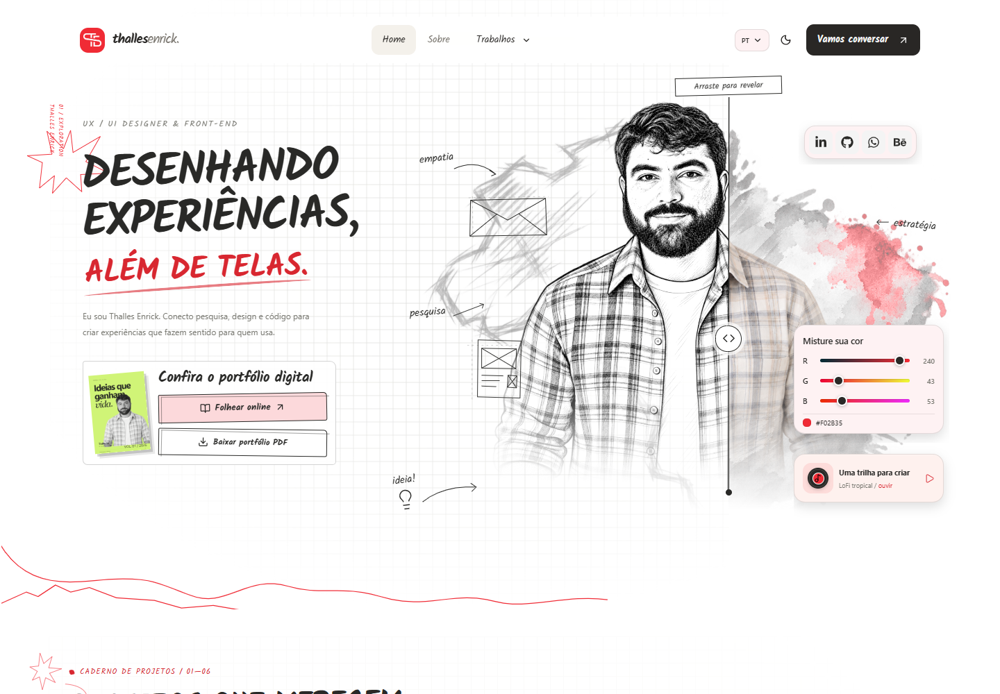

<div align="center">
  
  <h1>Thalles Enrick · Portfólio</h1>
  <p><strong>Pesquisa, design e código. Do croqui à interface.</strong></p>
  <p>Um portfólio de UX/UI e front-end que transforma a navegação em uma experiência de exploração: desenho, cor, movimento, música e uma revista digital para folhear.</p>
  <p>
    
    
    
    
    
  </p>
  <p><a href="#recursos">Recursos</a> · <a href="#tecnologias">Tecnologias</a> · <a href="#executar-localmente">Executar</a> · <a href="#estrutura">Estrutura</a> · <a href="#publicação">Publicação</a></p>
</div>



## Visão geral

O projeto apresenta o trabalho de **Thalles Enrick**, conectando pesquisa, experiência do usuário, linguagem visual e implementação front-end. A direção visual combina um caderno de exploração com interfaces modernas: o desenho revela o produto, e as interações ajudam a contar essa história.

A aplicação é uma **SPA em React e TypeScript**, construída com Vite, com layout responsivo e navegação entre apresentação profissional, projetos, estudos de caso, contato e portfólio editorial.

## Recursos

### Uma hero entre o desenho e o real

- Slider que revela as versões de croqui e fotografia do retrato e dos elementos próximos.
- Objetos de interface e anotações flutuantes, como carta, wireframe, empatia e pesquisa.
- Mapa do Brasil em aquarela e malha de desenho interativa.
- Misturador RGB que atualiza a cor de destaque e ajusta sua legibilidade conforme o tema.
- Bloco de redes sociais com LinkedIn, GitHub, WhatsApp e Behance, com aparência desenhada ou moderna conforme a revelação.
- Card com prévia da revista, leitura online e download do PDF.

### Movimento com intenção

- Temas claro e escuro com expansão radial a partir do botão, borda suave e uma pequena ondulação orgânica.
- Animações de entrada, interações de hover e efeito de clique com estrela e traços efêmeros.
- Indicador central de rolagem após **5 segundos sem atividade**; ao chegar ao fim, ele se transforma em um atalho para o topo.
- Respeito a `prefers-reduced-motion`, com alternativas sem animação para os principais movimentos.
- Preferências de tema e idioma persistidas no navegador.

### Música em dois estilos

O player usa a **YouTube IFrame Player API**, com cinco opções de lofi, soul brasileiro, MPB e groove. No croqui, um vinil gira durante a reprodução e um dial AM/FM permite sintonizar outra faixa por arraste. No lado real, há um seletor compacto.

Inclui reprodução/pausa, volume, avanço ao terminar uma faixa e abertura do vídeo original. A reprodução começa por interação da pessoa e depende da conexão e da disponibilidade dos vídeos no YouTube; os arquivos de áudio não são distribuídos pelo repositório.

### Projetos e revista digital

- Projetos de produto, aplicativos, sistemas e exploração visual.
- Estudos de caso de **RachAqui**, **Oryon System**, **Oryon Legis** e **PlayHub**.
- Galerias, detalhes de interfaces e interações demonstrativas específicas de cada case.
- Revista em `/portfolio`, com virada de páginas, arraste e navegação por teclado usando **StPageFlip**.
- PDF editorial de **10 páginas**, disponível em [`public/portfolio/`](public/portfolio/).

### Idiomas, contato e recuperação

- **Português, inglês e espanhol**, com seletores acessíveis por teclado.
- Formulário que prepara uma mensagem e abre o aplicativo de e-mail da pessoa por `mailto:`. O envio é confirmado nesse aplicativo; não há backend de mensagens.
- Página **404** para endereços inexistentes e tela de falha de carregamento.
- Tela de perda de conexão, com tentativa novamente e preservação dos campos já preenchidos enquanto a aplicação permanece aberta.
- Fallback offline em produção, disponível após a instalação do service worker, inclusive ao recarregar sem conexão.
- Ícone da aplicação derivado do símbolo da marca, com variantes SVG, PNG e Apple Touch Icon.

## Tecnologias

As versões abaixo são as **resolvidas no `package-lock.json`**. O `package.json` mantém os intervalos de atualização permitidos; `npm ci` reproduz o conjunto travado no lockfile.

### Aplicação e experiência

| Biblioteca | Versão resolvida | Papel no projeto |
| --- | --- | --- |
| [React](https://react.dev/) | `19.2.0` | Componentes, estado e composição da aplicação |
| React DOM | `19.2.0` | Renderização, portais e atualização sincronizada do tema |
| [React Router DOM](https://reactrouter.com/) | `7.9.4` | Rotas e navegação da SPA |
| [Tailwind CSS](https://tailwindcss.com/) | `4.1.14` | Utilitários de estilo e variantes de tema |
| `@tailwindcss/vite` | `4.1.14` | Integração do Tailwind com o build |
| [Framer Motion / Motion](https://motion.dev/) | `12.23.24` | Entradas, transições e movimentos orientados à interação |
| [StPageFlip](https://github.com/Nodlik/StPageFlip), pacote `page-flip` | `2.0.7` | Dobra, sombras e virada de páginas da revista |
| [Lucide React](https://lucide.dev/) | `0.545.0` | Ícones de interface |
| [React Icons](https://react-icons.github.io/react-icons/) | `5.5.0` | Símbolos das redes sociais |
| [GSAP](https://gsap.com/) | `3.13.0` | Dependência disponível para animações; sem importação direta no código atual |

**React Bits** também aparece como código local em [`src/components/react-bits/`](src/components/react-bits/), incluindo a malha visual da hero. Esses componentes não são uma dependência npm versionada neste projeto.

Alguns recursos usam APIs nativas do navegador: **View Transitions** e máscaras CSS na troca de tema; **Pointer Events** nos controles de arraste; **ResizeObserver** para medidas responsivas; e **Service Worker + Cache Storage** na tela offline. Se View Transitions não estiver disponível, a troca de tema continua funcionando sem o efeito radial.

### Desenvolvimento e qualidade

| Ferramenta | Versão resolvida | Uso |
| --- | --- | --- |
| Vite | `7.1.10` | Servidor de desenvolvimento e build de produção |
| TypeScript | `5.9.3` | Tipagem e verificação estática |
| `@vitejs/plugin-react` | `5.0.4` | Integração do React com o Vite |
| ESLint / `@eslint/js` | `9.37.0` | Análise estática do código |
| `typescript-eslint` | `8.46.1` | Regras e parser para TypeScript |
| `eslint-plugin-react-hooks` | `5.2.0` | Verificação dos hooks |
| `eslint-plugin-react-refresh` | `0.4.23` | Regras de compatibilidade com Fast Refresh |
| `globals` | `16.4.0` | Definições de globais para o lint |
| `@types/react` / `@types/react-dom` | `19.2.2` | Tipos das APIs React |
| `@types/node` | `24.7.2` | Tipos de Node.js para ferramentas e configuração |

## Executar localmente

### Pré-requisitos

- **Node.js `20.19+` na linha 20, ou `22.12+`** — conforme o requisito do Vite instalado.
- npm e um navegador moderno.

```bash
git clone https://github.com/thallesenrick/ux-portifolio.git
cd ux-portifolio
npm ci
npm run dev
```

Abra o endereço exibido pelo Vite no terminal.

### Variáveis de ambiente

Copie `.env.example` para `.env.local` e ajuste os valores necessários:

```dotenv
VITE_CONTACT_EMAIL=seu-email@exemplo.com
VITE_BEHANCE_URL=https://www.behance.net/seu-perfil
```

| Variável | Comportamento |
| --- | --- |
| `VITE_CONTACT_EMAIL` | Destino do formulário. Sem configuração, usa o contato definido no componente. |
| `VITE_BEHANCE_URL` | Perfil do Behance. Sem configuração, o botão abre a página inicial do serviço. |

Variáveis com prefixo `VITE_` ficam acessíveis no frontend e devem conter apenas configuração pública. Arquivos `.env` locais são ignorados pelo Git.

### Comandos

| Comando | Resultado |
| --- | --- |
| `npm ci` | Instala as versões do lockfile |
| `npm run dev` | Inicia o desenvolvimento com atualização em tempo real |
| `npm run build` | Executa a verificação de tipos e gera `dist/` |
| `npm run preview` | Serve o build localmente para revisão |
| `npm run lint` | Executa o ESLint |

## Rotas

| Caminho | Conteúdo |
| --- | --- |
| `/` | Hero, seleção de projetos, experiência e contato |
| `/about` | Perfil, áreas de atuação, referências e processo |
| `/projects` | Catálogo de projetos |
| `/projects/rachaqui` | Case de divisão de contas em grupo |
| `/projects/oryon` | Ecossistema ERP e aplicativos de proteção veicular |
| `/projects/oryon-legis` | Interfaces para sessões legislativas |
| `/projects/playhub` | Experiência de reservas esportivas |
| `/portfolio` | Revista digital com efeito de virar páginas |
| `/contact` | Formulário de contato |
| Demais caminhos | Página 404 |

## Estrutura

```text
ux-portifolio/
├── docs/                       # Prévia visual e documentação do repositório
├── public/
│   ├── portfolio/              # Capa e PDF para leitura/download
│   ├── favicon.svg             # Símbolo da marca
│   ├── offline.html            # Tela offline independente do bundle React
│   └── sw.js                   # Fallback de navegação sem conexão
├── scripts/
│   └── export-portfolio.cjs    # Exportação da revista para PDF e capa
├── src/
│   ├── assets/                 # Retratos, fontes, telas e artes dos projetos
│   ├── components/
│   │   ├── case-study/         # Apresentação e ampliação das interfaces
│   │   ├── commun/             # Hero, player, controles e seções compartilhadas
│   │   ├── react-bits/         # Componentes visuais locais de terceiros
│   │   └── ui/                 # Seletores e elementos de interface
│   ├── data/                   # Projetos, cases, perfil e playlist
│   ├── lib/                    # Contextos, traduções e integrações do navegador
│   ├── pages/                  # Páginas, revista e estados de erro
│   ├── types/                  # Declarações de tipos adicionais
│   ├── App.tsx                 # Rotas e composição da aplicação
│   └── main.tsx                # Inicialização e registro do service worker
├── .env.example
├── package.json
└── package-lock.json
```

### Onde atualizar o conteúdo

- **Projetos e galerias:** `src/data/projects.ts` e arquivos dos cases em `src/data/`.
- **Playlist:** `src/data/music.ts`. Ao substituir um vídeo, confira se ele permite reprodução incorporada.
- **Idiomas:** `src/lib/i18n-context.ts`, `src/lib/es.json` e os textos localizados dos componentes e cases.
- **Tema:** `src/lib/theme.tsx` e `src/lib/theme-transition.css`.
- **Revista:** `src/pages/Portfolio.tsx` e `src/pages/Portfolio.css`.
- **PDF e capa publicados:** `public/portfolio/`.

<details>
<summary><strong>Regenerar o PDF e a capa da revista</strong></summary>

O arquivo disponível para download já está incluído no repositório. A exportação é opcional e usa Chrome/Chromium com Playwright Core, que não faz parte das dependências normais da aplicação.

Instale a ferramenta localmente, sem alterar o manifesto ou o lockfile:

```bash
npm install --no-save --package-lock=false playwright-core
npm run dev -- --host 127.0.0.1 --port 4176
```

Em outro terminal, configure `PLAYWRIGHT_MODULE` e, se necessário, `CHROME_PATH`. Exemplo em PowerShell:

```powershell
$env:PLAYWRIGHT_MODULE = "playwright-core"
$env:CHROME_PATH = "C:\Program Files\Google\Chrome\Application\chrome.exe"
node scripts/export-portfolio.cjs
```

`PORTFOLIO_ORIGIN` permite apontar para outro servidor. O padrão do script é `http://127.0.0.1:4176`.

A exportação atualiza a capa e o PDF em `public/portfolio/`, grava uma cópia em `output/pdf/` e produz imagens de conferência em `tmp/portfolio-qa/`. Revise essas imagens e o PDF antes de publicar uma nova edição. Alterações no site não atualizam automaticamente o PDF já exportado.

</details>

## Qualidade e verificação

Os comandos de verificação disponíveis são:

```bash
npm run lint
npm run build
```

As interações foram verificadas em navegador de desktop e em larguras móveis, incluindo a revelação da hero, controles de música, dial, seletores, navegação da revista nos dois sentidos, tema radial, estados offline e recuperação de conexão. Os scripts e capturas de QA ficam em `tmp/`; não há um comando de suíte de testes configurado no `package.json`.

## Publicação

O resultado de `npm run build` fica em **`dist/`** e pode ser servido por hospedagem estática.

- Configure o host para servir `index.html` nas rotas da SPA; assim, links diretos para cases e para a revista funcionam com `BrowserRouter`.
- Preserve os arquivos de `public/`, especialmente `sw.js`, `offline.html`, os ícones e a pasta `portfolio/`.
- O service worker é registrado apenas no build de produção e requer **HTTPS ou localhost**. Ele guarda a tela offline e o ícone; a navegação conectada continua buscando a página na rede.
- A configuração atual usa caminhos a partir da raiz do domínio. Publicação em uma subpasta, como um site de projeto no GitHub Pages, exige ajustar a base do Vite, o roteador e os caminhos dos recursos.

## Créditos

Os componentes de React Bits mantêm sua licença em [`src/components/react-bits/LICENSE.md`](src/components/react-bits/LICENSE.md), incluindo a condição Commons Clause. As demais bibliotecas mantêm suas próprias licenças nos respectivos projetos. Este repositório não contém uma licença geral de redistribuição.

---

<div align="center">
  <strong>Thalles Enrick</strong><br />
  UX/UI · Product Design · Front-end<br /><br />
  <a href="https://www.linkedin.com/in/thallesenrick/">LinkedIn</a> ·
  <a href="https://github.com/thallesenrick">GitHub</a> ·
  <a href="https://wa.me/5588999463821">WhatsApp</a>
</div>
